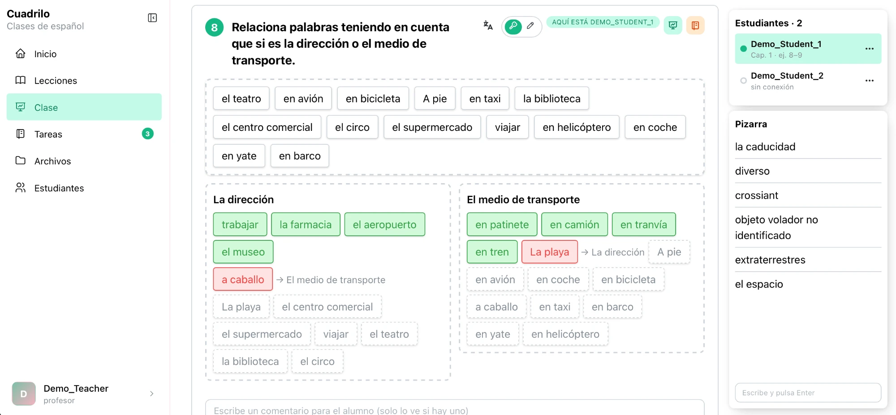
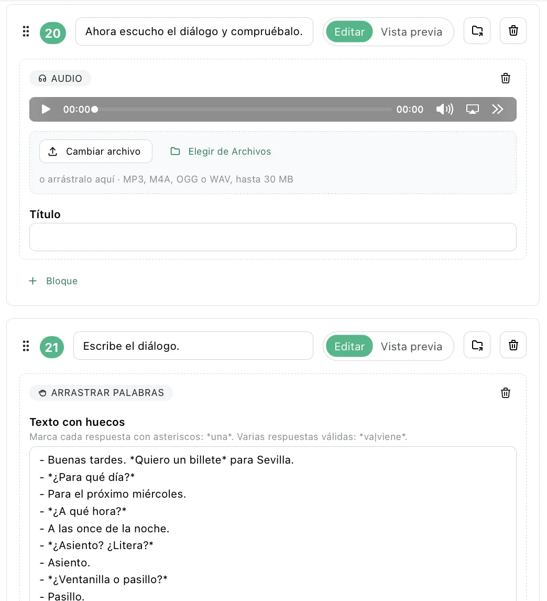
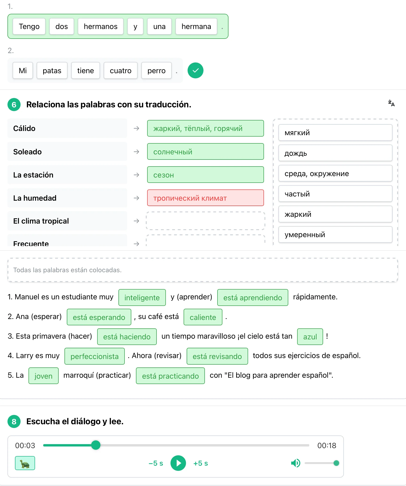

# Cuadrilo

**A self-hosted platform for interactive language lessons.** Build lessons from exercise blocks, run a live class, give homework and see the students' answers as they come in. A private place for one teacher's students, on the teacher's own server.

[](https://github.com/Shestac92/cuadrilo/actions/workflows/ci.yml)
[](https://github.com/Shestac92/cuadrilo/actions/workflows/audit.yml)
[](LICENSE)

[](https://buymeacoffee.com/shestac92)



## Features

- **21 kinds of blocks:** text, pictures, audio, video, and practice that checks itself.
- **Live class, one-to-one or for a group:** see answers in real time, spin a wheel of questions, draw on a shared board.
- **Homework** from any exercise, with the teacher's comments and highlights.
- **AI assistants:** Claude or ChatGPT create and edit lessons through the built-in MCP server.
- **Private:** login and password only, no analytics; the data is one folder you can copy.
- **Yours:** name, icon, colour themes, interface in Spanish or English, lessons in any language.
- **Translator:** click a word, get a translation from an offline dictionary; students keep a vocabulary.

Why it exists and who it is for: [Why Cuadrilo](docs/why.md).



## Connect an AI assistant

The MCP server lets Claude, ChatGPT or another assistant with custom connectors create and edit lessons and use your media library. It reads the format of every block from the server, so you only say what you want ("turn this worksheet into a lesson"). It cannot see students or their answers.

1. The server must be reachable over https. On a server installed by the [guide](deploy/INSTALL.md) it is. On your computer, set `PUBLIC_URL` to a tunnel address (ngrok, for example), run `npm run share` and point the tunnel at port 4173.
2. Sign in as the teacher, open **Asistentes IA** and copy the address `https://<your-address>/mcp`.
3. Claude: Settings → Connectors → Add custom connector. ChatGPT: Connectors → your own MCP server. Paste the address.
4. Sign in as the teacher on the consent page and press *Permitir*.

Details: [AI assistants](docs/ai-assistants.md).

## Quick start

Needs Node.js 22.13+.

```bash
git clone https://github.com/Shestac92/cuadrilo.git
cd cuadrilo
npm install
npm run dev
npm run create-teacher -w server -- teacher
```

The last command prints a generated password once. Open http://localhost:5173, sign in as `teacher` and add your students. Data lives in `./data`. Settings are optional: copy `.env.example` to `.env` ([Configuration](docs/configuration.md)). The translator needs `TRANSLATION_LANG` (the students' language).

On a server: **[deploy/INSTALL.md](deploy/INSTALL.md)** (domain, HTTPS with Caddy, systemd, backups, updates).

To let students in for a few lessons from your own computer, without a server: [Give students access from your computer](docs/share-from-your-computer.md) (ngrok).

**Forgot a teacher's password?** Run the same command with that login, on the machine with the data:

```bash
runuser -u cuadrilo -- npm run create-teacher -w server -- LOGIN
```

It prints a new password and signs the teacher out everywhere (assistants must be reconnected). Write the login exactly: an unknown one creates a new teacher.

## Supported browsers

Students and teachers need a reasonably current browser: **Safari 16.4+** (macOS 11 Big Sur or newer, iOS and iPadOS 16.4+), **Chrome 111+**, **Edge 111+** or **Firefox 114+**. These are the targets of Vite's default build (`baseline-widely-available`). In an older browser the app cannot start: instead of a blank page, the page asks the browser for its engine, version and system (on iPhone and iPad every browser runs on the system's Safari engine, so the iOS version counts) and, below these versions, says that the browser is too old and what to do (the text is in the interface language, `app.browserTooOld` in `shared/src/i18n`). A browser it does not recognise gets no notice.

## The 21 blocks

| Block | What it is | Answered by the student |
|---|---|---|
| `text` | Markdown text, tables, coloured words | no |
| `image` | a picture with a caption and a size | no |
| `compare` | two pictures with a before/after slider | no |
| `audio` | an audio file with a slow mode | no |
| `video` | a YouTube video, with a start time | no |
| `genially` | an embedded Genially | no (not saved here) |
| `wheel` | a wheel of fortune for speaking practice | no |
| `essay` | a free written answer | yes, not auto-checked |
| `gaps` | type the missing words | yes, checked |
| `dropdown-gaps` | pick the missing words from lists | yes, checked |
| `drag-gaps` | drag words from a bank into gaps | yes, checked |
| `build-word` | build words from shuffled letters | yes, checked |
| `match` | join pairs | yes, checked |
| `sort` | drag words into groups | yes, checked |
| `order` | put the words of a sentence in order | yes, checked |
| `sequence` | put whole sentences or dialogue lines in order | yes, checked |
| `choice` | a test with one or several right options | yes, checked |
| `true-false` | statements marked true or false | yes, checked |
| `dictation` | listen to a sentence and type it | yes, checked |
| `wordsearch` | find the words in a letter grid | yes, checked |
| `hotspots` | click the right zones on a picture | yes, checked |

The format of each block, with an example, is in [Lessons and the editor](docs/lessons.md); how they look and behave is in [Exercises](docs/exercises.md).



Fields and examples: [Lessons and the editor](docs/lessons.md).

## Documentation

[Why Cuadrilo](docs/why.md) · [From your computer](docs/share-from-your-computer.md) · [Configuration](docs/configuration.md) · [Lessons](docs/lessons.md) · [Exercises](docs/exercises.md) · [Classes](docs/classes.md) · [Answers and homework](docs/answers-and-homework.md) · [Roles and access](docs/roles-and-access.md) · [Translator](docs/translator.md) · [AI assistants](docs/ai-assistants.md) · [Security](docs/security.md) · [API](docs/api.md) · [Architecture](docs/architecture.md) · [Development](docs/development.md) · [Install on a server](deploy/INSTALL.md)

## Contributing

Bug reports, ideas and pull requests are welcome: see [CONTRIBUTING.md](CONTRIBUTING.md). Security problems: [SECURITY.md](SECURITY.md). Everyone follows the [Code of Conduct](CODE_OF_CONDUCT.md).

## Help wanted

Cuadrilo is built by one person, and these are the places where help matters most:

- **Mobile browsers.** Adapting the interface to phones and tablets and testing it in iOS Safari and Android Chrome.
- **License-free offline dictionaries.** The current ones come from Wiktionary (CC BY-SA 4.0). Dictionaries for more language pairs under permissive or public-domain licenses would make them easier to reuse.
- **Privacy documents and the law.** A review of `docs/privacy.*.md` and of what a teacher needs to meet data-protection rules in different regions (GDPR in the EU, the UK, the US and others), so that teachers do not run into local laws.
- **Testing.** Trying Cuadrilo on different platforms and browsers and reporting the bugs you find.
- **A demo server.** A small VPS and a domain for a public demo that teachers can try. It needs few resources, but it costs money: a sponsor, or someone willing to host it, would help.

If you can help, open an issue or write to the address below.

## Author

Created by **Aleksandr Shestakov**: [cuadrilo@duck.com](mailto:cuadrilo@duck.com) · [LinkedIn](https://www.linkedin.com/in/aleksandr-shestakov-58778985/)

<!-- Later: a count of confirmed installations (teachers using Cuadrilo in real lessons) and a section with teachers' reviews. -->

## Support

Cuadrilo is free. If it helps you, you can buy the author a coffee:

[](https://buymeacoffee.com/shestac92)

## License

Code: [MIT](LICENSE). The dictionaries in `dictionaries/` come from [Wiktionary](https://www.wiktionary.org/) and stay under **CC BY-SA 4.0** ([details](dictionaries/README.md)).
